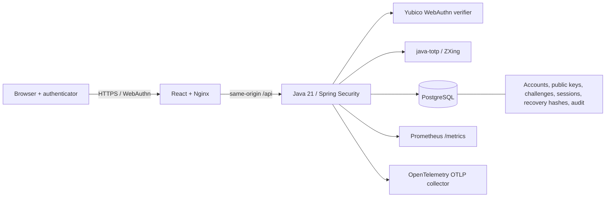

# Architecture and authentication sequences



The browser calls `navigator.credentials.create/get` using the native browser WebAuthn JSON serialization APIs. The Java relying party generates options and validates the complete WebAuthn response. `Store` implements Yubico's `CredentialRepository`. Data access uses parameterized Spring JDBC; Flyway owns schema changes.

## Registration

```mermaid
sequenceDiagram
  participant B as Browser
  participant A as API
  participant P as PostgreSQL
  participant K as Authenticator
  B->>A: GET /api/csrf
  A-->>B: Session-bound CSRF token
  B->>A: POST /registration/options (account name)
  A->>P: Store options, random binding hash, proposed account ID, 120s expiry
  A-->>B: Server-generated publicKey creation options + ceremonyId
  B->>K: credentials.create (residentKey required, UV required)
  K-->>B: Attestation + clientDataJSON + credential ID
  B->>A: POST /registration/finish
  A->>P: Atomic DELETE RETURNING challenge (independent committed transaction)
  A->>A: Yubico validates type, challenge, origin, RP hash, UP/UV, key and attestation
  A->>P: Insert account + public credential in one transaction
  A-->>B: Rotate session; FULL or PENDING MFA
```

No username reservation occurs until registration succeeds. Concurrent registrations for a name are resolved by the unique constraint; only one account can commit. Existing-account enrollment requires a recent full session or an unexpired recovery session with the exact same account owner. Ownership is rechecked when finishing. Registrations are capped at ten credentials per account under a row lock.

Both platform and roaming authenticators are allowed because `authenticatorAttachment` is unrestricted. Discoverable credentials and user verification are required. Attestation preference is `none`: the platform validates the protocol, not the authenticator vendor or hardware provenance. Private keys are generated and retained by authenticators or their passkey sync provider.

## Authentication and MFA

```mermaid
sequenceDiagram
  participant B as Browser
  participant A as API
  participant P as PostgreSQL
  participant K as Authenticator
  B->>A: POST /authentication/options
  A->>P: Store discoverable assertion request + binding + TTL
  A-->>B: publicKey request options + ceremonyId
  B->>K: credentials.get (UV required)
  K-->>B: Signed assertion + user handle
  B->>A: POST /authentication/finish
  A->>P: Burn challenge; lock owner and credential
  A->>A: Yubico verifies origin, RP, challenge, UP/UV, signature, owner and counter
  A->>P: Update counter, backup state and last-used timestamp
  alt TOTP enrolled
    A-->>B: Rotated PENDING session (5 minutes)
    B->>A: POST /mfa/totp or /mfa/recovery
    A->>P: Lock account; consume OTP timestep or recovery hash
    A-->>B: Rotated FULL session
  else No TOTP
    A-->>B: Rotated FULL session
  end
```

The challenge binding is a server-generated random value in the initiating session, independent of a guessable browser-supplied identifier. It is hashed in PostgreSQL. Each finish burns its challenge before protocol validation in a separately committed transaction; failures cannot restore it. Session mismatch does not burn another browser's challenge. No in-memory challenge cache or rate-limit store is used, allowing multiple replicas.

Monotonic signature counters are enforced where an authenticator supplies them. Authenticators that always return zero are allowed by the library's WebAuthn counter rules, including synchronized passkeys. The signed challenge, rather than a counter alone, supplies replay protection. Backup eligibility and current backup state are recorded.

## TOTP enrollment and recovery

```mermaid
sequenceDiagram
  participant B as Browser
  participant A as API
  participant P as PostgreSQL
  B->>A: POST /totp/enrollment (recent FULL session + CSRF)
  A->>A: Generate random 160-bit Base32 secret; encrypt AES-256-GCM
  A->>P: Save encrypted pending secret + five-minute expiry
  A-->>B: otpauth URI + locally rendered QR code
  B->>A: POST /totp/confirmation (six-digit code)
  A->>P: Lock account; verify RFC 6238; activate encrypted secret; burn timestep
  A->>P: Replace recovery-code hashes
  A-->>B: Ten random 160-bit recovery codes, shown once
  B->>A: POST /recovery (account name + one recovery code)
  A->>P: Lock account; atomically delete matching hash; revoke sessions
  A-->>B: RECOVERY session, five-minute TTL
  B->>A: Register a replacement passkey
  A-->>B: PENDING if TOTP enabled, otherwise FULL
```

A recovery code is a high-entropy bearer credential; secure offline storage is essential. Recovery never exposes account APIs or disables TOTP directly. After replacement enrollment, a separate unused code can satisfy pending MFA if the authenticator app was also lost. The user should remove lost passkeys and rotate remaining recovery codes after recovery.

## Transaction and authorization boundaries

- Account-row locks serialize TOTP verification, recovery redemption, credential deletion and credential-count checks.
- Challenge burns survive validation rollback. Recovery and TOTP changes commit before session elevation.
- `FULL`, `PENDING`, and `RECOVERY` session levels are explicit. Spring Security authorizes dashboard APIs only for `FULL`; ceremony/MFA endpoints enforce their own narrow session state.
- Sessions live in PostgreSQL using Spring Session JDBC and support cross-replica revocation. Session IDs rotate at authentication and privilege changes.
- Audit writes use independent transactions so failed authentication attempts remain visible even when the main transaction rolls back. Audit records intentionally contain no request bodies, OTPs, secrets, credential blobs or recovery codes.
- Prometheus labels have bounded event/outcome values. HTTP server spans are exported with the OpenTelemetry bridge; trace IDs correlate with stored audit events.
